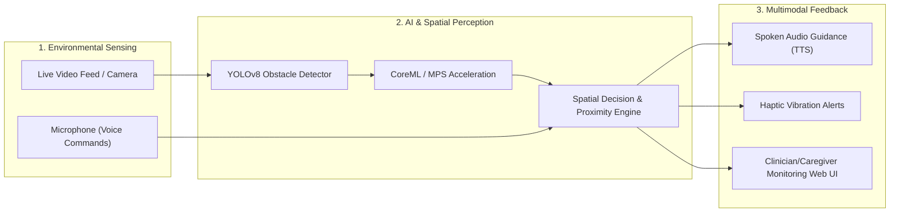

# BlindNav: Real-Time Assistive Vision & Navigation for the Visually Impaired

[](https://ultralytics.com)
[](https://fastapi.tiangolo.com)
[](https://reactnative.dev)
[](https://apple.github.io/coremltools/)
[](LICENSE)

**BlindNav** is an intelligent, multimodal assistive navigation system designed to empower visually impaired and blind individuals to navigate indoor and outdoor environments safely and independently. 

By combining **on-device computer vision (YOLOv8)**, **real-time spatial obstacle detection**, **voice destination input**, and **haptic/audio spoken guidance**, BlindNav translates visual scenes into immediate, actionable acoustic navigation instructions.

---

## Table of Contents
- [System Overview & Architecture](#system-overview--architecture)
- [Key Features](#key-features)
- [Repository Structure](#repository-structure)
- [Quick Start Guide](#quick-start-guide)
  - [1. Machine Learning & Backend Server (`ml/`)](#1-machine-learning--backend-server-ml)
  - [2. Mobile Application (`mobile/BlindNav/`)](#2-mobile-application-mobileblindnav)
  - [3. Web Simulation Interface (`web/`)](#3-web-simulation-interface-web)
- [CoreML & Native Acceleration](#coreml--native-acceleration)
- [API Reference](#api-reference)
- [Project Roadmap](#project-roadmap)
- [Contributing](#contributing)
- [License](#license)

---

## System Overview & Architecture



BlindNav operates as a unified perception-to-speech loop:
1. **Perception**: Captures continuous camera frames from the mobile device.
2. **Detection & Spatial Analysis**: Identifies hazards, doors, steps, chairs, vehicles, and pedestrians, estimating their distance and relative angle (e.g., *"Chair 2 meters directly ahead"*).
3. **Voice Navigation Dialogue**: Understands user verbal destination queries using automatic speech recognition.
4. **Spoken Feedback**: Emits prioritized, non-intrusive directional audio prompts (e.g., *"Step down ahead, proceed slightly to the right"*).

---

## Key Features

- **Real-Time Obstacle & Hazard Detection**: Fine-tuned YOLOv8 neural network trained specifically on everyday navigation obstacles and hazards.
- **On-Device CoreML Export**: Low-latency edge inference on iOS utilizing Apple Neural Engine and Metal Performance Shaders (MPS).
- **FastAPI Dev & Inference Server**: Lightweight backend for remote frame inference, testing, and simulation.
- **Voice-Activated Commands**: Hands-free destination input and status requests via voice recognition.
- **Text-to-Speech (TTS) Acoustic Navigation**: Turn-by-turn auditory spatial cues that avoid overwhelming the user's natural hearing.
- **Interactive Web Simulation Dashboard**: Vite + React web interface for testing detection models, streaming live camera frames, and evaluating path planning algorithms.

---

## Repository Structure

```
BlindNav/
├── ml/                               # Machine Learning & Detection Backend
│   ├── detect.py                     # CLI obstacle detection on images/streams
│   ├── export.py                     # Model export to CoreML, ONNX, and TFLite
│   ├── train.py                      # YOLOv8 model training script
│   ├── server.py                     # FastAPI REST API & simulation endpoints
│   ├── requirements.txt              # PyTorch, Ultralytics, and FastAPI deps
│   └── README.md                     # ML specific setup documentation
├── mobile/BlindNav/                  # Cross-Platform React Native App
│   ├── src/
│   │   ├── App.tsx                   # Main mobile application view
│   │   ├── camera/frameProcessor.ts  # Frame capture & vision processing
│   │   ├── nav/navigation.ts         # Spatial navigation calculation
│   │   ├── voice/voice.ts            # Speech-to-Text & Text-to-Speech handlers
│   │   └── types/native.d.ts         # TypeScript native module bindings
│   ├── ios/                          # Native iOS Xcode workspace & Pods
│   ├── android/                      # Native Android Gradle project
│   ├── package.json
│   └── app.json
├── web/                              # Web Simulation & Caregiver Portal
│   ├── src/                          # React + TypeScript source
│   ├── index.html                    # Web view entry
│   ├── vite.config.ts                # Vite build configuration
│   └── package.json
├── scripts/                          # Automated environment bootstrap scripts
│   ├── setup_ml_env.sh               # Python virtualenv & dependency setup
│   └── setup_mobile_env.sh           # React Native & Node dependency setup
├── README_ENV_SETUP.md               # Detailed developer environment guide
├── TODO.md                           # Milestone task tracking
└── .gitignore
```

---

## Quick Start Guide

### Prerequisites
- **Python**: 3.10 or 3.11
- **Node.js**: v18+ and npm / yarn
- **Xcode** (for iOS build) / **Android Studio** (for Android build)

---

### 1. Machine Learning & Backend Server (`ml/`)

```bash
# 1. Run automated environment setup
./scripts/setup_ml_env.sh

# Or setup manually:
cd ml
python3 -m venv .venv
source .venv/bin/activate
pip install -r requirements.txt

# 2. Verify Apple Silicon (MPS) or GPU support
python -c "import torch; print('MPS Available:', torch.backends.mps.is_available())"

# 3. Test detection on a sample image
python detect.py /path/to/test_image.jpg --model yolov8n.pt

# 4. Start the FastAPI development server
uvicorn server:app --reload --host 127.0.0.1 --port 8000
```

Verify backend health:
```bash
curl http://127.0.0.1:8000/
```

---

### 2. Mobile Application (`mobile/BlindNav/`)

```bash
# 1. Run mobile bootstrap script
./scripts/setup_mobile_env.sh

# 2. Start Metro bundler
cd mobile/BlindNav
npm run start -- --port 8081

# 3. In a separate terminal, launch iOS or Android:
npm run ios      # For iOS Simulator / connected device
npm run android  # For Android Emulator / connected device

# 4. Typecheck TypeScript:
npm run typecheck
```

---

### 3. Web Simulation Interface (`web/`)

```bash
cd web
npm install
npm run dev
```
Open [http://localhost:5173](http://localhost:5173) in your browser to test camera inputs and evaluate navigation feedback in real time.

---

## CoreML & Native Acceleration

To achieve near-instantaneous edge inference (<30ms per frame) on mobile devices without relying on network latency:

```bash
cd ml
source .venv/bin/activate

# Export trained PyTorch weights to Apple CoreML
python export.py runs/blindnav/obstacle-detector/weights/best.pt --output-dir exports
```
The exported `.mlpackage` binds directly to the native iOS module `BlindNavDetector`.

---

## API Reference

The FastAPI development backend (`ml/server.py`) provides the following endpoints:

| Endpoint | Method | Description |
| :--- | :--- | :--- |
| `/` | `GET` | Health check and detector status |
| `/detect` | `POST` | Upload an image frame (`multipart/form-data`) and receive detected bounding boxes, classes, and distances |
| `/simulate` | `POST` | Simulate detection and receive navigation audio text without requiring a live camera frame |

---

## Project Roadmap

- [x] YOLOv8 obstacle detection model pipeline & training scripts.
- [x] CoreML conversion and Apple Silicon hardware acceleration.
- [x] React Native camera frame capture & Text-to-Speech audio engine.
- [x] FastAPI simulation endpoints for automated UI testing.
- [ ] Integration of LiDAR depth sensing for mm-level distance accuracy.
- [ ] Multilingual spoken navigation commands (Spanish, French, Swahili).
- [ ] Wearable smart-glasses hardware integration.

---

## Contributing

Contributions are welcome! Please follow these steps:
1. Fork the repository.
2. Create a descriptive branch: `git checkout -b feature/lidar-depth-fusion`.
3. Commit your changes: `git commit -m 'feat: integrate LiDAR distance fusion'`.
4. Push to your branch: `git push origin feature/lidar-depth-fusion`.
5. Open a Pull Request.

---

## License

This project is licensed under the MIT License — see the [LICENSE](LICENSE) file for details.
